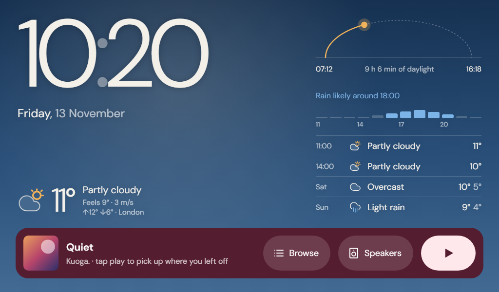
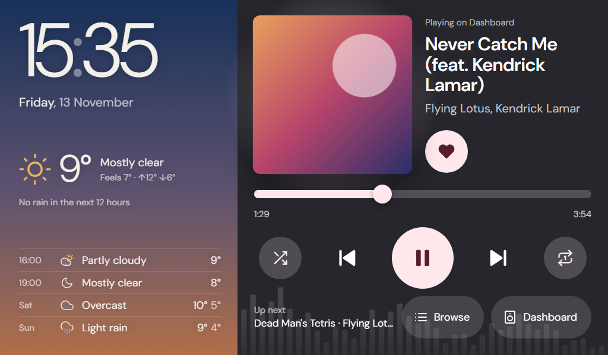
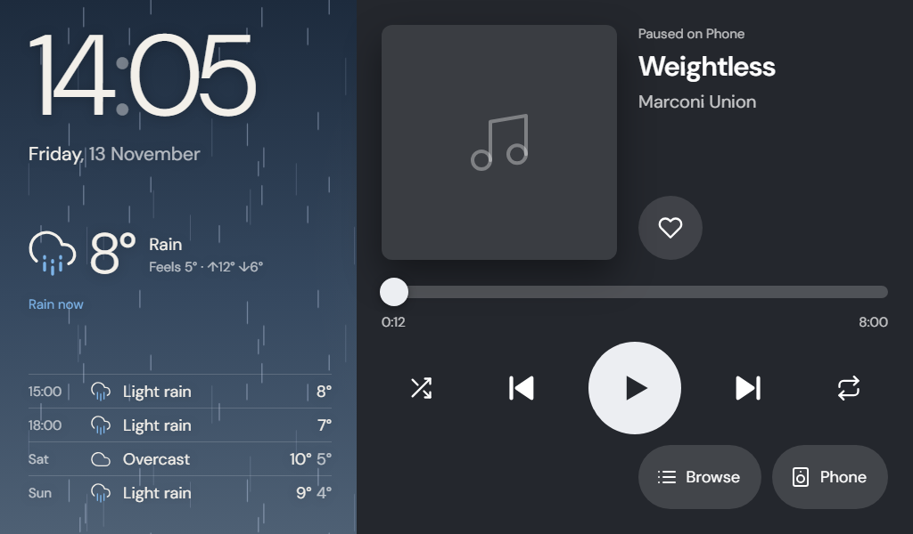
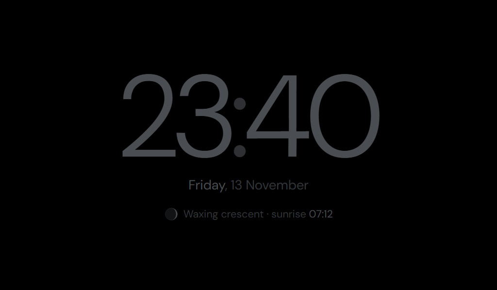

# Nest Hub dashboard

Keeps a custom page on a Google Nest Hub instead of its ambient screen:
time, date, weather and the rain forecast for the next hours on the left, a
Spotify player on the right.

Behind the time and weather is the sky as it is outside: its colours follow
today's sunrise and sunset (dawn, day, golden hour, dusk, night), clouds grey
it, rain or snow falls across it, and stars come out on clear nights. An arc
shows the sun's path today. While music plays here, a soft spectrum in the
cover's colour moves with it and the cover breathes with the bass. The night
clock shows the moon's phase and the next sunrise.

| | |
|---|---|
|  |  |
| *Morning, with rain on the way and the last song ready to resume* | *Golden hour, music playing on the dashboard* |
|  |  |
| *Rain now; a song paused on another device* | *Night: a dim clock, the moon's phase, the next sunrise* |

- `server.py` serves the page, fetches weather (Open-Meteo), and runs the
  keeper: whenever the Hub is idle it casts the page, and re-casts if the page
  stops reporting in. Other Cast apps are left alone; the dashboard returns
  when the Hub goes idle again.
- `spotify.py` handles the one-time Spotify sign-in and talks to the official
  Spotify Web API (what's playing, play/pause, skip, resume). Volume is
  left to the Hub's own buttons.
- `player.py` is the dashboard's own Spotify player: it runs Chrome on the
  server with Spotify's official web player (`web/engine.html`), records
  Chrome's sound and serves it as a stream.
- `web/index.html` is the page on the Hub. It registers itself as a Cast
  receiver with the idle timeout disabled, which is what stops the Hub from
  closing it, and it plays the server's audio stream. While music plays the
  page takes the colour of the album cover, picked with Google's
  `material-color-utilities` (bundled in `web/vendor/material-color.js`).

## How music works

The Hub shows one Cast app at a time, so for music to come out of the Hub
while the dashboard stays on screen, the dashboard itself has to make the
sound. The Hub's browser cannot run Spotify's web player, so that player runs
in Chrome inside the container instead. It appears in Spotify as a device
(named by `SPOTIFY_PLAYER_NAME`, default "Dashboard"), and its sound is
streamed to the page, which plays it through the Hub's speaker.

- The play button resumes your last Spotify session on that device.
- The list button offers Liked Songs (your 300 most recently liked tracks:
  Spotify's API cannot play the whole collection), your playlists and what you
  played lately; the
  speaker button moves the music to any device Spotify offers.
- Like, shuffle, repeat, tapping the progress bar to jump, and the next track
  are on the card; the album cover fills it while music plays.
- You can also pick "Dashboard" as the device in any Spotify app.
- If Spotify's own app starts on the Hub (for example after "Hey Google,
  play..."), the service notes the track and position, closes that app, re-casts
  the dashboard and continues the music there (`VOICE_TAKEOVER`).
- The Hub holds back the sound of a freshly cast page until the screen is
  touched, but lets a page that reloads itself play at once. So when music
  should come out of the dashboard (after "Hey Google", or picked from a
  phone) and the sound is held, the page reloads itself once, which takes
  about a second, and the music is heard without a tap.
- Pause and skip reach the speaker about half a second later, because the
  sound travels server -> page.
- Spotify Premium is required (a rule of Spotify's web player).

## HTTPS address

Point a hostname with a publicly trusted certificate at the service, e.g. a
reverse-proxy entry `https://hub.example.com` -> `http://<server>:8765`.
Spotify's sign-in only returns to an `https://` address, the Hub must be able
to resolve the name (it may use Google's DNS, not yours) and it only trusts
public certificate authorities. Then set `PUBLIC_URL=https://hub.example.com/`.
The proxy must pass long-lived responses through (`/api/audio` is an endless
stream).

## Spotify setup (once)

1. At developer.spotify.com/dashboard create an app. Add the redirect URI
   `https://hub.example.com/api/spotify/callback` (your address) and tick
   "Web API" and "Web Playback SDK". Spotify Premium is required.
2. Set `SPOTIFY_CLIENT_ID` to the app's client ID. The redirect address is
   derived from `PUBLIC_URL`; set `SPOTIFY_REDIRECT_URI` only if it differs.
3. Open `https://hub.example.com/api/spotify/login` in a browser and sign in.
   The sign-in is saved in `data/spotify.json`.

When an update needs more permissions from Spotify (likes and playlists came
with 0.3.0), the playlist list shows a "sign in again" line; repeat step 3.

Spotify only allows `https://` redirect addresses, or `http://127.0.0.1` (the
default when the dashboard's address is plain http, for running locally).

## Your own Cast app (optional, for voice-started music)

1. Register at cast.google.com/publish (one-time fee), add a new application
   of type "Custom Receiver" with the dashboard's HTTPS address as the
   receiver URL, and note its app ID.
2. In the same console add the Hub as a test device by serial number, wait
   until it shows as ready, then restart the Hub.
3. Set `CAST_APP_ID` to the app ID.

## Screenshots

The pictures above come from `python tools/screenshots.py`, which serves the
page with made-up weather for London and captures it in headless Chrome at the
Hub's 1024x600. Run it after any change to how the page looks and commit the
new images with that change.

## Releases

The `VERSION` file is the release trigger.

```bash
python tools/release.py patch
```

Commit the bump and push to `main`. The Release workflow then runs the syntax
check and tests, tags `vX.Y.Z`, and publishes the image to GitHub's container
registry as `ghcr.io/<owner>/<repo>:X.Y.Z` and `:latest`. Pushes that don't
change the version publish nothing. Use `minor` / `major` for bigger changes,
or just edit the file.

The published image is private while the package is private: either make the
package public (GitHub → your profile → Packages → the package → Package
settings), or run `docker login ghcr.io` on the server with a token that has
`read:packages`.

## Deploy on a Linux server

Put `docker-compose.yml` and a `.env` (see `.env.example`) in a folder on the
server, then:

```bash
docker compose pull && docker compose up -d
```

The image is for x86-64 only and is large (about 1.5 GB) because it contains
Chrome; expect a few hundred MB of memory in use.

To update after a release, run that command again. The container starts as
root only to make the mounted `data` folder writable, then runs the service
as an unprivileged user (uid 1000). To build from source
instead of pulling, copy the whole repository and use
`docker compose up -d --build`.

Settings are environment variables, set in `.env`. Compose refuses to start
(and names the variable) while a required one is missing.

Required:

| Variable | Meaning |
|---|---|
| `HUB_HOST` | The Hub's IP address. Give it a fixed DHCP lease. |
| `PUBLIC_URL` | The dashboard's HTTPS address, which the Hub loads the page from. |
| `TZ` | Timezone of the clock, e.g. `Europe/London`. |
| `WEATHER_NAME`, `WEATHER_LAT`, `WEATHER_LON` | Weather location: label and coordinates. |
| `SPOTIFY_CLIENT_ID` | Your Spotify app's client ID. |

Optional:

| Variable | Default | Meaning |
|---|---|---|
| `PORT` | `8765` | Port the page is served on; the reverse proxy points here. |
| `HOUR12` | `false` | 12-hour clock. |
| `NIGHT_FROM`, `NIGHT_TO` | `23:00`, `07:00` | Night mode: a dim clock only while nothing plays; a touch brings the dashboard back for a minute. `NIGHT_FROM=off` disables it. |
| `SPOTIFY_REDIRECT_URI` | `PUBLIC_URL` + `api/spotify/callback` | Where Spotify returns after sign-in. |
| `SPOTIFY_PLAYER_NAME` | `Dashboard` | Name of the dashboard's own player in Spotify. |
| `CAST_APP_ID` | public DashCast app | Your own Cast app ID. |
| `VOICE_TAKEOVER` | `true` | Move Spotify sessions started on the Hub into the dashboard. |
| `HUBDASH_IMAGE` | published `:latest` | Image to run, e.g. to pin a release. |
| `DATA_PATH` | `./data` | Folder that holds the Spotify sign-in. |

Only one instance may point at a Hub; two would keep re-casting over each other.

## Check it

- `http://<server>:8765/` shows the page in a browser. Add `?demo=playing` or
  `?demo=idle` to see the player states without Spotify.
  `?at=HH:MM` shows the sky at another hour (the clock stays real) and
  `?wx=<code>` other weather (an Open-Meteo weather code: 0 clear, 3 overcast,
  63 rain, 73 snow, 95 thunder), e.g. `?demo=idle&at=16:00&wx=0`.
- `http://<server>:8765/api/debug` shows the keeper state, the Hub's last
  heartbeat (including the layout it measured on its own screen), the player
  state, and recent events.
  `spotify_errors` lists the latest requests Spotify refused.
  Under `local` it shows the built-in player (`ready` when Chrome is signed
  in to Spotify, and how many pages are listening to its sound); under
  `beat.audio` it shows what the Hub's page is doing with that sound.
  `beat.sent` counts the page's heartbeats that got through or failed (with
  the last error), `beat.timers` any long pause in the page's timers (the
  page was frozen) and `beat.mem` its memory use; a failed heartbeat also
  shows up under `events` as `beat-failed`.
- `docker logs -f hubdash` shows the same events live.

## Local development (Windows)

```bash
python -m venv .venv
```

```bash
.venv\Scripts\python.exe -m pip install -r requirements.txt
```

```bash
.venv\Scripts\python.exe server.py --no-keeper
```

Copy `config.example.json` to `config.json`; it supplies settings when the
environment variables are not set. `--no-keeper` serves the page without
casting it. The built-in player needs Chrome and PulseAudio, so it only runs
in the container; `--test-tone` streams a beep instead, to try the page's
sound path (open `http://localhost:8765/?player=1`).

```bash
.venv\Scripts\python.exe -m unittest discover -s tests
```

`tools/discover.py` lists Cast devices on the network and
`tools/status.py <hub-ip>` prints what the Hub is running.

## License

MIT, see [LICENSE](LICENSE).
